# Lab Book

<!--
Template for a new entry (copy and paste to the bottom):

---

## DD/MM/YYYY – Short title

**Aims:**
- ...

**Work:**

...

**Results:**

(For a second topic on the same day, use a ### subheading.)
-->

---

## 15/10/2026 – Importing data and first Black-Scholes prices

**Work:**
- Imported data from WRDS: data_import_wrds.py
- Added black scholes call function `black_scholes_call(S, K, sigma, r, t)`
- Applied `black_scholes_call(S, K, sigma, r, t)` to call data using mean implied volatility
- Noticed that using the exact implied volatility of a given call doesn't lead to a perfectly priced call. Potentially due to not taking dividends into account.

---

## 21/10/2026 – Dividends and the Merton model

**Aims:**
- Understand why using exact implied volatility doesn't lead to perfect option price, and fix if possible.

**Work:**

A potential cause of the implied volatility not matching is due to not taking into account the dividend yield. The Merton model takes dividends into account in its calculation. When I searched it up I found that European options use the Black-Scholes-Merton model to calculate the implied volatility.

**Results:**

The Merton model decreased the MSE significantly, especially for longer expiry options, however a slight mismatch remains.

---

## 27/10/2026 – Realised volatility

**Aims:**
- To implement realised vol

**Work:**

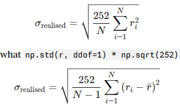

The top one shows the zero-mean version of the realised volatility which is used more commonly. The bottom one shows the textbook definition of the realised volatility. The zero-mean is used in practice usually, we looked into the reason, it's something to do with the P&L not being accurate when you use the textbook version, but we didn't really understand it. We will implement both to compare accuracy.

We made the data importing methods so they could be imported when needed. We plotted the black-scholes using implied, historical (zero meaned), historical (demeaned) volatilities, and plotted against time.

**Results:**

There is not much difference between the 2 versions of historical vol, however it can be seen that it is sometimes off from the true market price. Since they are almost identical, we can abandon the demeaned historical vol, and use just the zero-mean historical vol, which has a slightly lower RMSE:

| Vol method | RMSE ($) |
|---|---|
| zero-mean historical vol | 48.567 |
| demeaned historical vol | 48.869 |

(measured with `rmse_bs_overall.py` on 06/11/2026)

---

## 02/11/2026 – VIX volatility

**Aims:**
- To implement VIX volatility using black scholes model and compare to realised vol

**Work:**

**Results:**

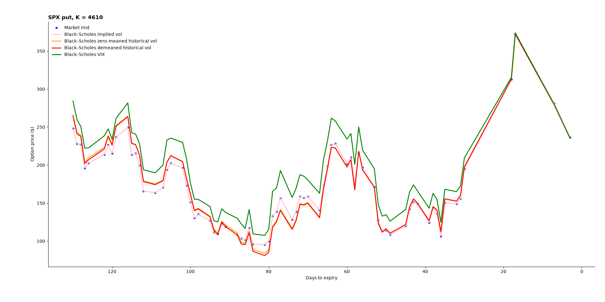

---

## 02/11/2026 – Plotting per sector

**Aims:**
- To be able to plot per sector

**Work:**

We don't have European options of sectors grouped, so we will use American ones instead. Apparently the European ones are too illiquid to be reliable anyways.

There is no index options data available for certain sectors after 2019, therefore we have to use the ETFs instead. We will have to state the approximation of American options as European options.

### Dividend rate for ETFs

The dividend rate isn't available for ETFs, so we need to calculate it ourselves. Dividend rates for European index options that we have been using until now use CP parity, to calculate the implied dividend rate from the market prices. This contains the market prices so technically if used, it is a circular argument. That means that the prices we have done so far have been circular arguments.

Another way to calculate the dividend rate is by using the past dividends, and assume that it will be the same for the lifetime of the option. This can be:
- **Continuous:** measure the total dividends paid in the last year, divide by the current stock price and convert to continuous compounding: q = ln(1 + D/S)
- **Discrete:** assume the dates and amounts of the dividends paid last year will be the same this year, so calculate the dividends that are suggested to be paid within the lifetime of the option, take away from the stock price, and calc option price using q = 0

We will use the continuous dividend, as it is easier to calculate. We may also want to consider lagging the q used for the previous calcs on the SPX, to stop it from being circular.

---

## 03/11/2026 – Numerical justification for volatility method

**Aims:**
- To obtain numerical justification for volatility method

**Work:**

"The importance of the loss function in option valuation", states that:
1. Models should be trained and evaluated on the same loss function (or quantified error), otherwise it will result in a suboptimal model.
2. When comparing models we should use the same loss function to compare throughout.

Christoffersen & Jacobs found that parameters chosen to minimise squared dollar errors also perform reasonably well when judged by other error measures. We will use the RMSE as it shares the benefits of the MSE but is easier to interpret.

**Results:**

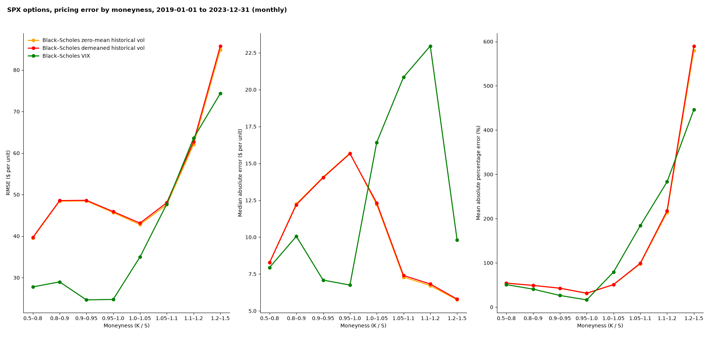

---

## 06/11/2026 – Choosing the error measure

**Aims:**
- To decide what error to use

**Work:**
### Errors wrt option price

Dimitri in our 3rd meeting suggested investigating what the different error quantifying methods measure. We first measure the errors wrt the option price:

The RMSE starts lower, and increases with the options price, whereas the MAPE does the opposite. This is as expected as for the same absolute error, the percentage error will be greater for smaller option prices than greater option prices.

We will use RMSE as the value to compare different option pricing approaches, and to train our ML selector. This is because MSE is the industry standard, so it is easy to compare to other papers. We could also do the whole project but with Median Abs, and compare to RMSE, if we have enough time.

### Sampling dates

I changed the code from taking options from the first day of every month, to taking data from every Wednesday, but if Wednesday is a holiday then take Tuesday instead. I chose Wednesday because it is the least likely day to be a holiday, which allows consistency. This means other literature uses this as well making the results more comparable.

### RMSE by sector

I noticed that the RMSE was much greater for the SPX than the sector ETFs:

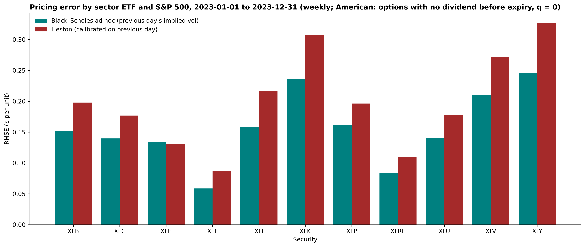

This is mainly due to the SPX being a lot more expensive than the ETFs. Which is proven by the MPE (mean percentage error):

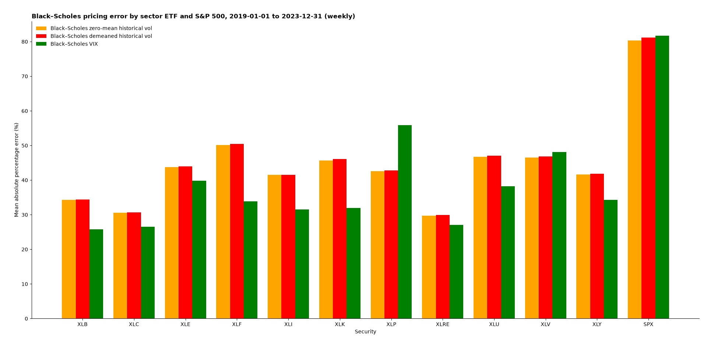

The errors can be seen to be a lot closer, however the SPX error is still greater, suggesting that the SPX being more expensive doesn't fully account for the difference in error.

### Dividends, q, for American options

**SPX:** hundreds of companies go ex-dividend on different days, so dividends trickle out almost every day. Treating them as a smooth, continuous yield q is a fair approximation, and this is how q, the value we import, is treated when being computed.

**Sector ETFs & Stocks:** dividends come in four lumps a year, on the Monday after the third Friday of Mar/Jun/Sep/Dec, just after the quarterly option expiry. The options are American so the Black-Scholes formula should not work, however if we choose a period of time in which there are no dividend payments, for a call option, then the Black-Scholes formula can be used.

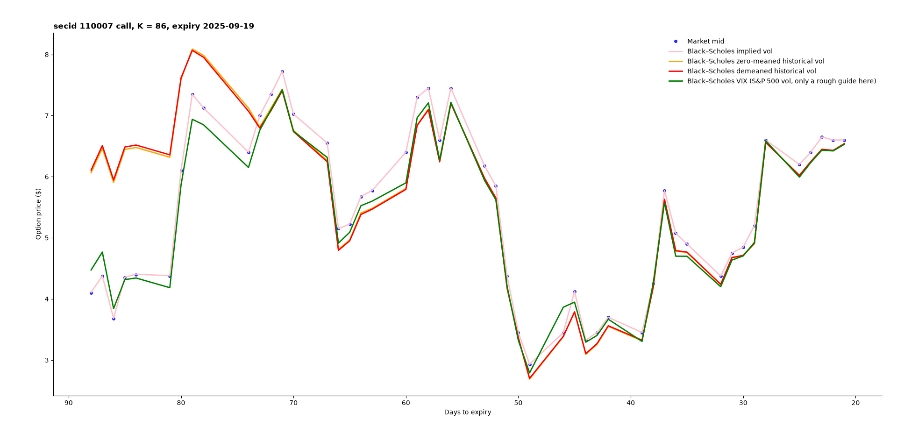

Figure shows the implied volatility being plugged into the Black-Scholes model working near perfectly, despite the option being American. This is due to choosing a call option during a time when there are no dividend payments.

## 15/11/2026 – Working on Heston Model

**Aims:**
- To understand what the Heston model code is doing better

**Work:**
- Got claude to simplify the code slightly

My understanding of the Quad method:

What the code is doing, is fourier transform with a negative sign in the exponent (the usual convention is to call this a forward fourier transform), on the characteristic function, to give the probability distribution function, which can be used to give a price.

The charateristic function is the FT of the pdf (or IFT depending on how you define it, it has a positive exponent). Starting from the Heston PDE, if you sub in a ansatz (inspired from the black-scholes model solution), which is a function of 2 pdfs, and sub it into the heston PDE, you get 2 PDEs for the 2 pdfs. There is a theorem (Feynman–Kac theorem) that states that the characteristic function should also obay the same PDEs. Therefore you can sub in the characteristic functions into the PDEs. Then by guessing the form of the solution, you can reduce the PDEs into ODEs, and solve for the characteristic functions. Then you need to Inverse FT the 2 characteristic functions to get the option price (or forward ft depending on ur definition, its negative exponent).

---

## 16/10/2026 – Comparing the Heston model to the Black-Scholes model

**Aims:**

- To quantify the errors of the Heston model so that it can be compared to the BS model
- To produce figures of the Heston model error wrt time, maturity, moneyness, option price, and sector
- To implement code which allows us to price individual stocks
- To research ML models

**Work:**

I found out that 2025-08-29 is the last day that wrds has options data

**Results:**

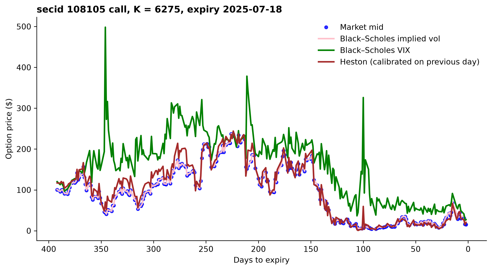

The Heston model can be seen outperforming the VIX Black-Scholes model. Over the whole lifetime of the S&P 500 index option.

The Heston model can be seen outperforming the 3 Black-Scholes approaches for all maturities.

The Heston model can be seen outperforming the 3 Black-Scholes approaches for all moneyness values.

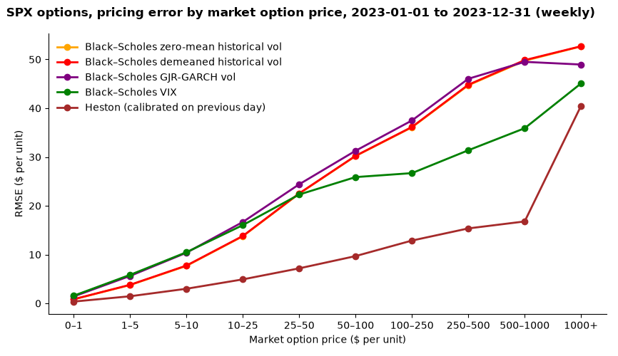

The Heston model can be seen outperforming the 3 Black-Scholes approaches for all option price values.

The Heston model can be seen outperforming the 3 Black-Scholes approaches for all sectors. The results in this figure, suggest that VIX is the least accurate of the 3 volatility methods for many of the sectors. This dissagrees with the previous results in which the VIX was the best out of the vol methods, except for energy, and consumer staples. This change in results could be due to the change in the dates measured, or potentially due to now only options that dont overlap with the dividend exdate are considered.

**Overall pricing error, SPX, 2023 (weekly, Wednesdays)**

| Method | RMSE ($) |
|---|---:|
| Heston (calibrated on previous day) | 16.07 |
| Black–Scholes, VIX | 26.78 |
| Black–Scholes, zero-mean historical vol | 33.96 |
| Black–Scholes, GJR-GARCH vol | 34.28 |

The Heston model prediction vs the market prices for Microsoft stocks. I did plot the VIX vol Black-Scholes prediction here, as it is more complicated to implement the VIX for non S&P 500 indices.

---

## 17/11/2026 – Phase 1: Machine Learning Baseline with Random Forest

**Aims:**
- Implement the first machine learning baseline for option pricing using a Random Forest.
- Formulate a scale-invariant prediction target that remains valid as the underlying index moves to new price levels.
- Build a non-leaking feature pipeline using today's observable market parameters alongside prior volatility expectations.
- Establish an expanding-window walk-forward validation strategy to benchmark against Black-Scholes and Heston.

**Work:**

### Why Start with Random Forest?
Before testing complex architectures like neural networks or boosting, Random Forest serves as the standard, robust benchmark for non-linear regression on tabular financial data:
1. **No feature scaling needed:** Unlike neural networks, decision trees are invariant to monotonic transformations and do not require normalization or standardization of inputs with different units (e.g. strike in dollars vs time in years).
2. **Handles non-linear relationships:** The volatility surface exhibits pronounced smile/skew curvature that linear models cannot capture; tree splits naturally partition the moneyness-maturity space into localized regimes.
3. **Robust against overfitting (Bagging):** By training 100+ trees on random bootstrap subsets of options and random feature subsets, individual tree errors cancel out when predictions are averaged.

### Target Formulation: Normalized Price ($C / S$)
If a model is trained directly on dollar option prices, it encounters a major breakdown:
- In early 2023, the S&P 500 traded near 3,800; by late 2023, it traded above 4,750.
- Decision trees are partition-based step functions and **cannot extrapolate** beyond the range of target values seen in training.
- By dividing the option mid-price by today's spot price ($C / S$), an at-the-money call looks economically identical whether the index is at 3,800 or 4,800. Dollar prices are recovered at inference simply by multiplying by today's spot: $\widehat{\text{Price}} = \widehat{y} \times S$.

### Feature Selection and Preventing Look-Ahead Leakage
We use all contract specifications known **today**:
- **Today's contract terms:** Today's strike $K$, today's spot price $S$, today's time to maturity $T$, today's risk-free rate $r$, and today's dividend yield $q$.
- **Moneyness:** $K / S$ and forward moneyness $\ln(K / F)$, where $F = S e^{(r-q)T}$.
- **The Look-Ahead Trap:** Quoted implied volatility (`impl_volatility`) in WRDS is calculated from today's closing option price. Giving today's IV to the model gives it the answer. Therefore, volatility information is strictly lagged by 1 week (`iv_lag`).
- **Surface Imputation (k-d Tree):** When options with new strikes or expiries are listed mid-year, they have no quote from the prior week. We use a 2D spatial `cKDTree` on $(\ln(K/F), \sqrt{T})$ to find the nearest option quoted last week and use its IV as an anchor, setting `is_new = 1`.

### Walk-Forward Cross-Validation
A standard random 80/20 train/test split is invalid for options data because options quoted on the same day share the same macro environment, spot price, and interest rates. Randomly splitting options across the same day leaks contemporaneous cross-sectional information into the test set. Instead, we use an expanding-window walk-forward test: training strictly on past months to predict the next month.

**Limitations of Random Forest:**
While Random Forest establishes a reliable baseline, bagging trains trees independently. If trees systematically misprice deep out-of-the-money options, averaging them does not fix the bias. This motivates moving to Gradient Boosted Decision Trees in Phase 2.

---

## 17/11/2026 – Phase 2: Gradient Boosted Trees for Option Pricing (HistGradientBoosting / LightGBM)

**Aims:**
- Advance from independent-tree bagging (Random Forest) to sequential error-correcting **Gradient Boosted Decision Trees (GBDT)**.
- Price **both calls and puts** simultaneously in a single model using contract indicators and signed delta.
- Verify that today's contract parameters ($S, K, T, r, q$) are fully leveraged while strictly lagging volatility to prevent leakage.
- Build a drop-in `predict_chain(df)` function matching `heston_price_chain` to compare directly against Heston and Black-Scholes in `comparing_models`.
- Serialize the trained production model to disk (`.joblib`) for zero-overhead inference.

**Work:**

### Boosting vs. Bagging (Why Gradient Boosting Wins)
- **Random Forest (Bagging):** Trees are built in parallel and vote independently. They do not communicate or learn from each other's mistakes.
- **Gradient Boosted Trees (Boosting):** Trees are trained **sequentially** like a team of editors. Tree 1 makes a baseline prediction. Tree 2 is trained specifically to predict the *residual errors* (mistakes) of Tree 1. Tree 3 corrects Tree 2, and so on.
- Each tree takes a small step (controlled by a learning rate $\eta = 0.08$) in the direction that minimizes squared dollar error. This systematically drives down residual pricing bias across tricky regions of the volatility smile.

### Why `HistGradientBoosting`?
Classic gradient boosting algorithms check every unique floating-point value for split points, which is prohibitively slow for datasets with hundreds of thousands of option quotes. `HistGradientBoostingRegressor` (scikit-learn's implementation of the LightGBM algorithm) discretizes continuous features into 256 integer bins (histograms). This speeds up tree construction by $10\times$ to $20\times$ while acting as a natural regularizer against market quote noise.

### Feature Pipeline: Today's Contract State + Lagged Volatility
To address any confusion regarding what data is used:
1. **Observable TODAY (Used fully by the model):**
   - $S$ (Today's spot price of the index).
   - $K$ (Today's strike price).
   - $T$ (Today's time to maturity in years).
   - $r, q$ (Today's risk-free rate and dividend yield).
   - `moneyness` ($K / S$) and `log_mF` ($\ln(K / F)$ where $F = S e^{(r-q)T}$).
   - `is_call` (1 for Call, 0 for Put).
   - `spot_ret` (1-week log return up to today: $\ln(S_t / S_{t-1})$).
   - Final dollar conversion: $\widehat{\text{Price}} = \widehat{y} \times S_{\text{today}}$.
2. **Lagged from Last Week (To prevent look-ahead leakage):**
   - `iv_lag`: The option's implied volatility from the previous week (with contract-specific call/put k-d tree interpolation for newly listed options).
   - `delta_lag`: Black-Scholes delta computed using **today's** $S, K, T, r, q$, evaluated with *last week's* IV. For calls, $\Delta \in [0, 1]$; for puts, $\Delta \in [-1, 0]$. This signed delta smoothly conveys both moneyness and option direction in a single continuous feature.
   - `atm_iv_lag`: The median IV of ~1-month ATM options from last week (market fear gauge).

### The Three Target Formulations & The Black-Scholes Benchmark

Initial testing of the direct normalized price ($C/S, P/S$) across all 732,904 options (both calls and puts) yielded an informative result:
- $R^2 = 0.9983$ (explains 99.8% of market variance)
- Yet GBM RMSE was **$\$23.69$**, whereas the Lagged Black-Scholes Benchmark achieved **$\$6.71$**.
- By contrast, `random_forest.py` had an RMSE of $\approx \$9$.

**Why did this discrepancy occur?**
1. **Calls-Only vs. Calls + Puts:** `random_forest.py` evaluated **calls only** (~350k quotes). For calls, price monotonically decreases with strike. Puts slope in the opposite direction and have massive intrinsic dollar values (\$1,000+) at high strikes. Combining both doubled the difficulty of the function to be learned.
2. **Tree Capacity (Leaf Count):** `RandomForestRegressor` ran with `max_depth=None` and `min_samples_leaf=5`, allowing each tree to grow thousands of leaves (nearly 1,000,000 total split regions). In contrast, standard GBM initialized with only 31 leaves, which underfit a 730k-row combined call/put dataset.
3. **The Step-Function Error on Deep In-The-Money Options:** In options, Black-Scholes guarantees exact linear intrinsic value ($S - Ke^{-rT}$). Deep ITM options have Vega $\approx 0$, so even with last week's IV, Black-Scholes prices them with almost $\$0.00$ error. A decision tree, however, outputs flat step-functions. An error of just 0.5% in normalized space on a \$1,000 option produces a **$\$22.50$ error on a single option**, heavily inflating RMSE.

**The Solution: Three Supported Target Formulations in `gbm.py`:**
To resolve this and provide a rigorous comparison, `gbm.py` was structured with a `METHOD` switch (`"price_over_S"`, `"residual"`, `"iv"`, or `"all"` to run all three):
1. **Direct Normalized Price (`price_over_S`):** Fits $y = \text{mid} / S$; $\widehat{\text{Price}} = \widehat{y} \times S$. Learns everything from scratch.
2. **Residual over Black-Scholes (`residual`):** Fits $y = \text{mid} - \text{benchmark\_price}$; $\widehat{\text{Price}} = \text{benchmark\_price} + \widehat{y}$. Black-Scholes handles intrinsic value and discounting analytically; the tree only learns the small $\$1–\$3$ smile/skew residual.
3. **Implied Volatility (`iv`):** Fits $y = \sigma_{\text{implied}}$; $\widehat{\text{Price}} = \text{BlackScholes}(S, K, \widehat{\sigma}, r, T, q)$. By feeding the predicted volatility through the analytical Black-Scholes formula, put-call parity and intrinsic value bounds are 100% mathematically guaranteed by construction.

### Key Observations & Conceptual Insights:

1. **Why BS Benchmark Achieves $\$6.71$ Here vs. $\$26–\$34$ in `comparing_models`:**
   - Both use the **identical** pricing functions (`black_scholes_call` and `black_scholes_put` from `bs_funcs.py`).
   - In `comparing_models`, Black-Scholes used a **flat volatility** across all strikes (VIX $\approx 17\%$, or 60-day historical vol $\approx 15\%$). A flat volatility has zero smile or skew, leading to large errors on out-of-the-money and in-the-money options.
   - In the ML benchmark, Black-Scholes is given **`iv_lag`** (each contract's own market implied volatility from 7 days ago). Because market implied volatility is highly persistent over short periods, last week's smile already captures ~95% of real market pricing, creating an exceptionally strong baseline.

2. **Why Residual vs. IV Formulation Varies Across Models:**
   - **Residual Method:** Directly optimizes squared dollar error ($(\text{Price} - \widehat{\text{Price}})^2$). Random Forest averages 100 unconstrained trees (nearly 1,000,000 total partitions), creating an inherently smooth blend that excels at direct dollar residual fitting on calls.
   - **IV Method:** Minimizes error in volatility space ($(\sigma - \widehat{\sigma})^2$). When decoded through Black-Scholes, options with low sensitivity to volatility (deep ITM and OTM options with Vega $\approx 0$) naturally damp out the tree's step errors to $\$0.00$. Black-Scholes acts as a non-linear "shock absorber", which is especially advantageous for gradient boosted trees pricing both calls and puts.

### Deliverables & Interface:
- Standalone execution script: `source/ML_models/gbm.py` (with `METHOD` and `CP_FILTER` controls at the top).
- Walk-forward test over March–December 2023 with monthly tracking of Call, Put, and Combined RMSE against the Black-Scholes benchmark.
- Standardized `predict_chain(df, method="residual", model)` function matching `heston_price_chain(df, params_by_date)`.
- Serialized production models saved to `source/ML_models/saved/gbm_{method}_model.joblib`.
- Diagnostic scatter plots saved to `figures/gbm_{method}_vs_market.png`.

**Limitations and Next Step (Phase 3):**
Decision trees create piecewise-constant step functions, meaning the predicted pricing surface is composed of flat local tiles rather than an infinitely smooth surface. This causes jagged numerical derivatives (Greeks like Gamma). In Phase 3, we move to **Multi-Layer Perceptrons (MLPs)** and neural networks to produce continuous, differentiable surfaces, laying the groundwork for Physics-Informed Neural Networks (PINNs).

## 17/10/2026 – Random Forests

**Aims:**

- To implement the random forest model

**Work:**

We calculated the errors and the feature importances for the S&P 500 model over 2023 wednesdays. Each month is used as the test data, and then the average error is taken over all the months.

    `model = RandomForestRegressor(
        n_estimators=100,      # number of trees in the forest
        min_samples_leaf=5,    # each leaf must contain at least 5 options (stops overfitting)
        n_jobs=-1,             # use all CPU cores
        random_state=0,        # makes the results repeatable
    )`

**Results:**

RMSE:9.24

Feature importance (higher = more useful):
  log_mF      0.971
  moneyness   0.021
  T           0.005
  delta_lag   0.003
  iv_lag      0.000
  r           0.000
  spot_ret    0.000
  atm_iv_lag  0.000
  q           0.000
  is_new      0.000

I tried removing log_mF and got the following:

  RMSE:                10.67

Feature importance (higher = more useful):
  moneyness   0.968
  delta_lag   0.016
  T           0.015
  iv_lag      0.000
  spot_ret    0.000
  r           0.000
  q           0.000
  atm_iv_lag  0.000
  is_new      0.000

  This suggests that the main reason that log_mF is so high, is because it contains information of the moneyness, and after it got removed, the forest started using the moneyness directly. Hence why it shot up in importance.

  To check this I removed the moneyness too and go the following:

  RMSE:                108.62

Feature importance (higher = more useful):
  iv_lag      0.746
  T           0.184
  delta_lag   0.061
  atm_iv_lag  0.003
  is_new      0.002
  r           0.001
  spot_ret    0.001
  q           0.000

  The root mean square blew up suggesting that the information of the moneyness of the option is key to pricing the option accuratly.

  I added a hyperparameter optimiser:

 ` search = RandomizedSearchCV(
    RandomForestRegressor(random_state=0),
    param_options,
    n_iter=20,                               # try 20 random combinations
    cv=TimeSeriesSplit(n_splits=3),
    scoring="neg_root_mean_squared_error",
    n_jobs=-1,
    random_state=0,
)`

this reduced the RMSE to: 9.13

---

## 19/11/2026 – lagged IV Black–Scholes model

**Aims:**
- Implement the lagged IV Black–Scholes model, and compare it to the other Black_Scholes models and the Heston model.

**Work:**

Implement the lagged IV Black_Scholes model: when past implied volatilities are used to predict todays volatility, which is then used in the Black-Schole model to predict a price.

We will first implement the following:
- Uses the same options, previous trading days implied volatility. If the previous day does not exist, then that option will not be used.

**Results:**

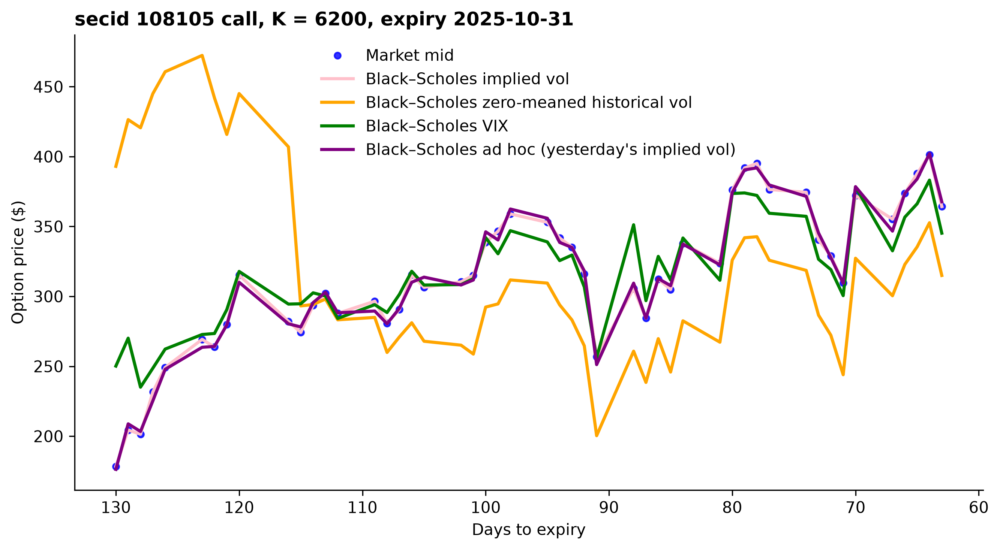
Followed option 169092814 from 2025-06-23 to expiry 2025-10-31. The lagged IV BS can be seen outperforming all other vol estimation methods for this option.

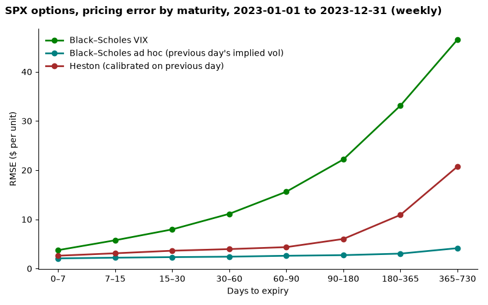
Lagged IV BS outperforms the Heston model for all maturities.

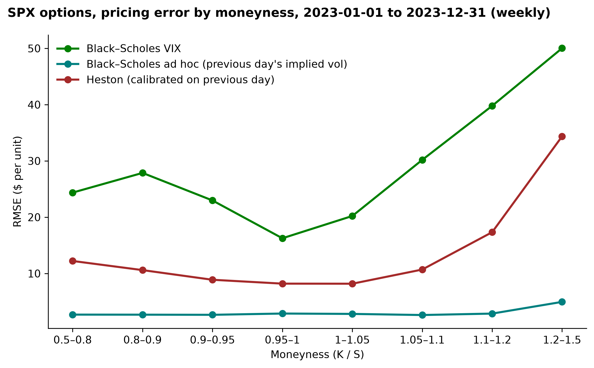
Lagged IV BS outperforms the Heston model for all moneyness.

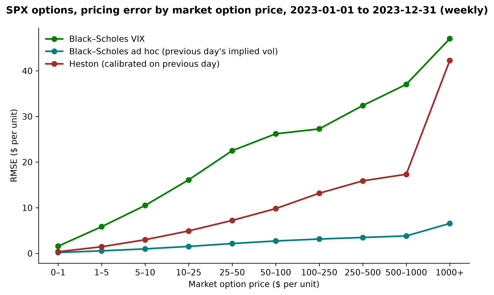
Lagged IV BS outperforms the Heston model for all option prices.

For 2023 the Lagged IV outperforms the Heston for all sectors except energy. the energy sector is known to be bery volatile, which makes me think that the Lagged IV perhaps doesnt perform well for volatile (or perhaps high vol of vol) options.

To test this I did the Lagged IV on volatile individual stock options.

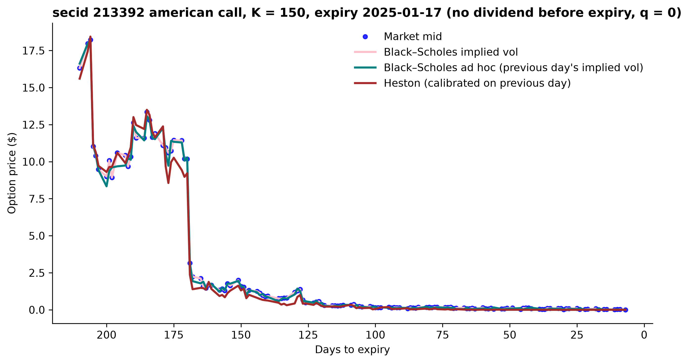
Its not obvious which model does better. This was a stock that i read online is known to be volatile.

However even on this stock, for 2023 overall the Lagged IV method outperformed the Heston

**MSE ($):**

Black–Scholes lagged IV (previous day's implied vol): 1.764

Heston (calibrated on previous day): 2.161
