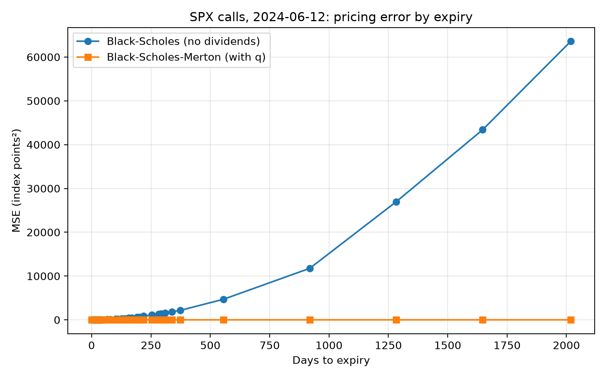
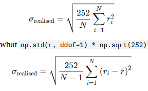
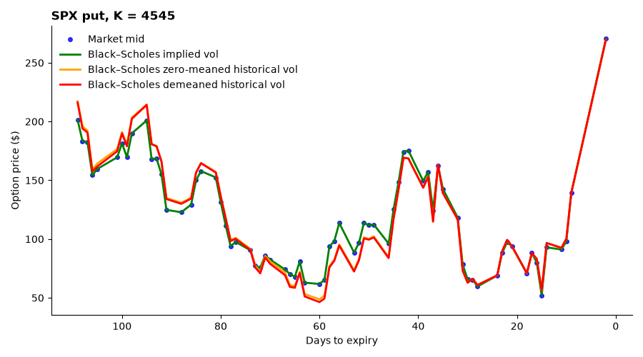
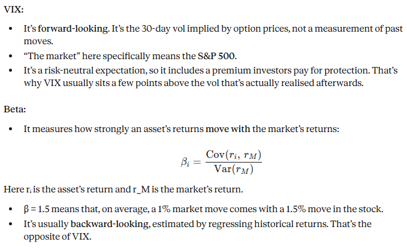
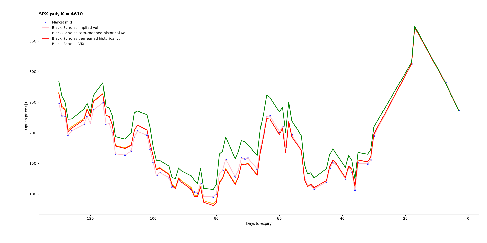
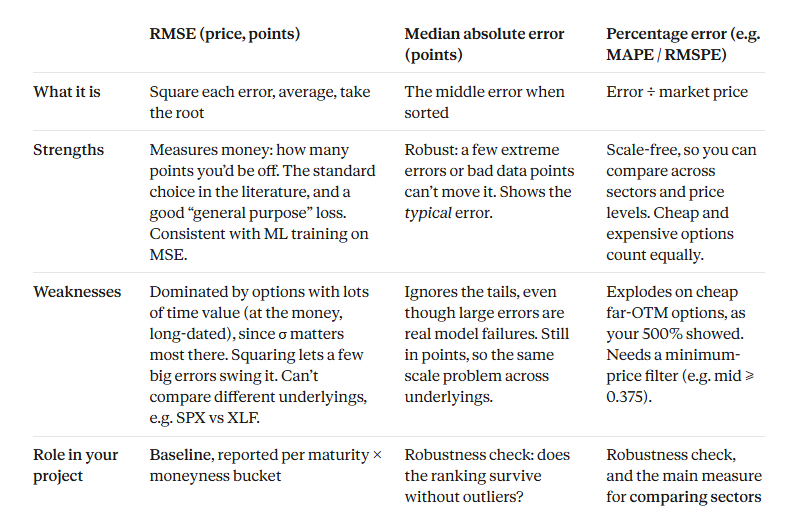

## 15/10/26
- Imported data from WRDS: data_import_wrds.py
- Added black scholes call function `black_scholes_call(S, K, sigma, r, t)`
- Applied `black_scholes_call(S, K, sigma, r, t)` to call data using mean implied volatility
- Notices that using the exact implied volatility of a given call, doesnt lead to a perfects priced call. Potentially due to not taking dividends into account.

## 21/10/26
**Aims:**
- Understand why using exact implied volatility doesnt lead to perfect option price, and fix if possible.

A potential cause of the implied volatility not matching is due to not taking into account the dividends yield. The merton model takes into accound dividends into its calculation. When i searched it up i found that european options use the black scholed merton model to calculate the implied volatility.

**Results:**
The merton model decreased the MSE significantly, especially for longer expiry options, however a slight missmatch remains.

## 27/10/26
**Aims:**
- To implement realised vol

The top one shows the zero-mean version of the realised volatility which is used more commonly. The bottom one shows the textbook definition of the realised volatility. The zero-mean is used in practice usually, we looked into the reason, its something to do with the P&L not being accurate when you use the textbook version, but we didnt really understand it. We will implement both to compare accuracy.

We made the data importing methods so they could be imported when needed. We plotted the black-scholes using implied, historical (zero meaned), historical (demeaned) volatilities, and plotted against time.

**Results:**

There can not be much difference between the 2 versions of historical vol, however it can be seen that it is sometimes off from the true market price.

## 02/11/26
**Aims:**
- To implement VIX volatility using black scholes model and compare to realised vol

**Results:**

## 02/11/26
**Aims:**
- To be able to plot per sector

We dont have european options of sectors grouped, so we will use american ones instead. Apparently the european ones are too illiquid to be reliable anyways.

There is no index options data available for certain sectors after 2019, therefore we have to use the ETFs intead. We will have to state the approximation of American options as European options.

The dividend rate isnt available for ETFs, so we need to calculate it ourselves. Dividend rates for european index options that we have been using until now use CP parity, to calculate the implied dividend rate from the market prices. This contains the market prices so technically if used, it is a circular argument. That means that the prices we have done so far have been circular arguments. Another way to calculate the dividend rate is by using the past dividends, and assume that it will be the same for the lifetime of the option. This can be continuous (measure the total dividends paid in the last year, divide by the current stock price and convert to continuous compounding: q = ln(1 + D/S)), or discrete (assume the dates and ammounts of the dividends paid last year will be the same this year, so calcualte the dividends that are suggested to be paid within the lifetime of the option, take away from the stock price, and calc option price using q = 0). We will use the continuous dividend, as it is easier to calculate. We may also want to consider lagging the q used for the previous calcs on the SXP, to stop it from being circular.

## 03/11/2026

**Aims:**

- To obtain numerical justification for volatility method

"The importance of the loss function in option valuation", states that 1. Models should be trained and evaluated on the same loss function (or quantified error), otherwise it will result in an inoptimal model. 2. When comparing models we should use the same loss function to compare throughout.

Christoffersen & Jacobs found that parameters chosen to minimise squared dollar errors also perform reasonably well when judged by other error measures. We will use the RMSE as it shares the benifits of the MSE but is easier to interpret.
