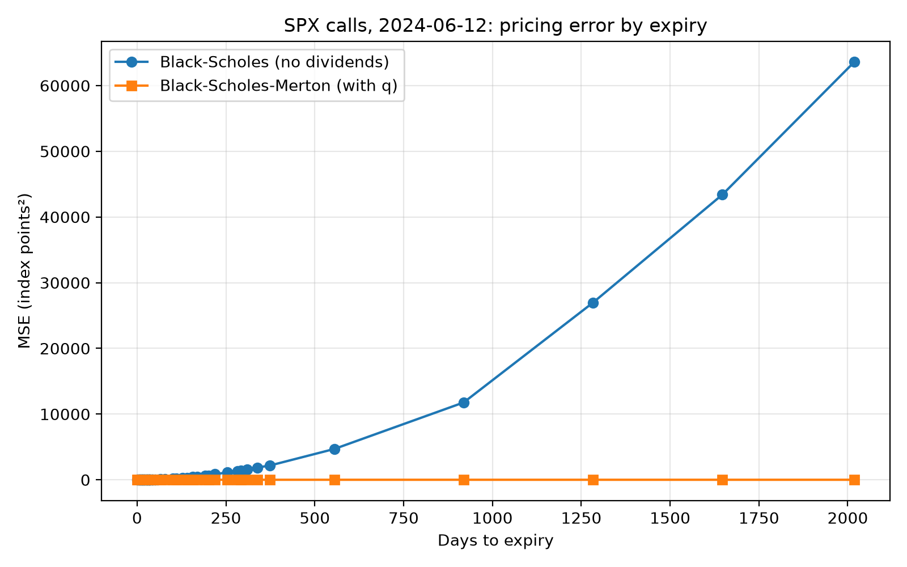
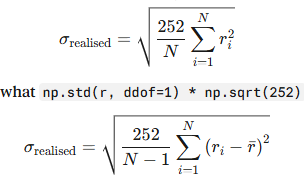
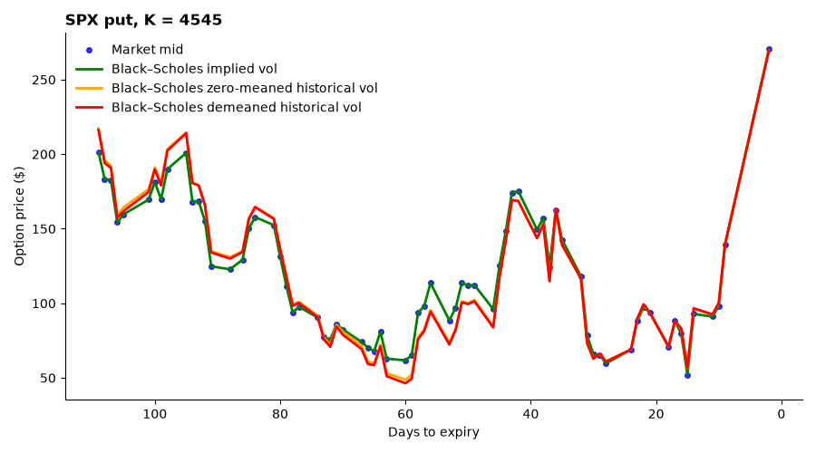

## 15/10/26
- Imported data from WRDS: data_import_wrds.py
- Added black scholes call function `black_scholes_call(S, K, sigma, r, t)`
- Applied `black_scholes_call(S, K, sigma, r, t)` to call data using mean implied volatility
- Notices that using the exact implied volatility of a given call, doesnt lead to a perfects priced call. Potentially due to not taking dividends into account.

## 21/10/26
**Aims:**
- Understand why using exact implied volatility doesnt lead to perfect option price, and fix if possible.

A potential cause of the implied volatility not matching is due to not taking into account the dividends yield. The merton model takes into accound dividends into its calculation. When i searched it up i found that european options use the black scholed merton model to calculate the implied volatility.

**Results:**
The merton model decreased the MSE significantly, especially for longer expiry options, however a slight missmatch remains.

## 27/10/26
**Aims:**
- To implement realised vol

The top one shows the zero-mean version of the realised volatility which is used more commonly. The bottom one shows the textbook definition of the realised volatility. The zero-mean is used in practice usually, we looked into the reason, its something to do with the P&L not being accurate when you use the textbook version, but we didnt really understand it. We will implement both to compare accuracy.

We made the data importing methods so they could be imported when needed. We plotted the black-scholes using implied, historical (zero meaned), historical (demeaned) volatilities, and plotted against time.

**Results:**

There can not be much difference between the 2 versions of historical vol, however it can be seen that it is sometimes off from the true market price.