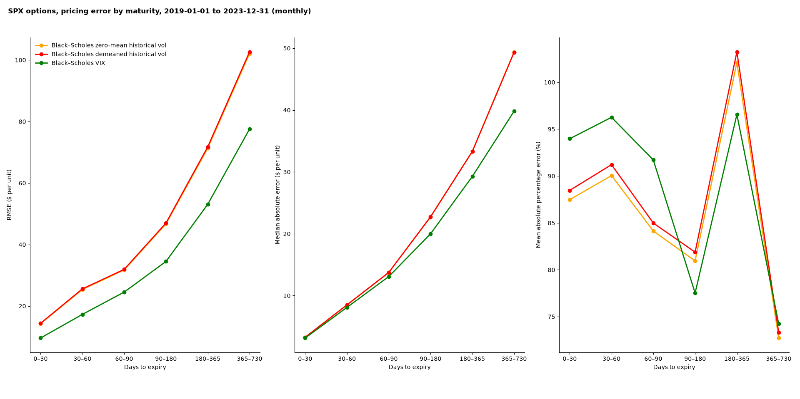
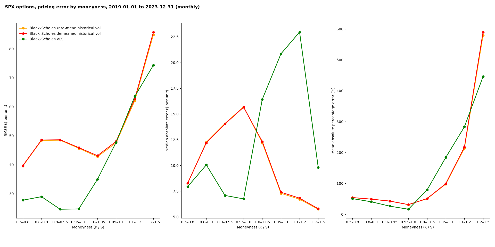
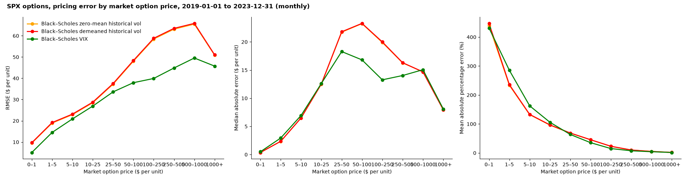
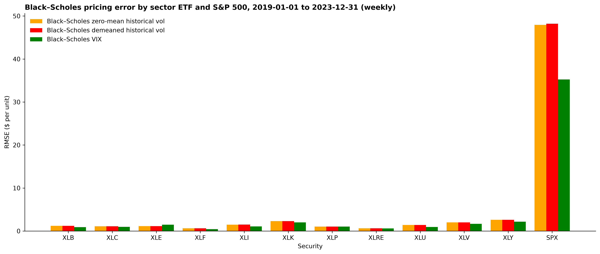
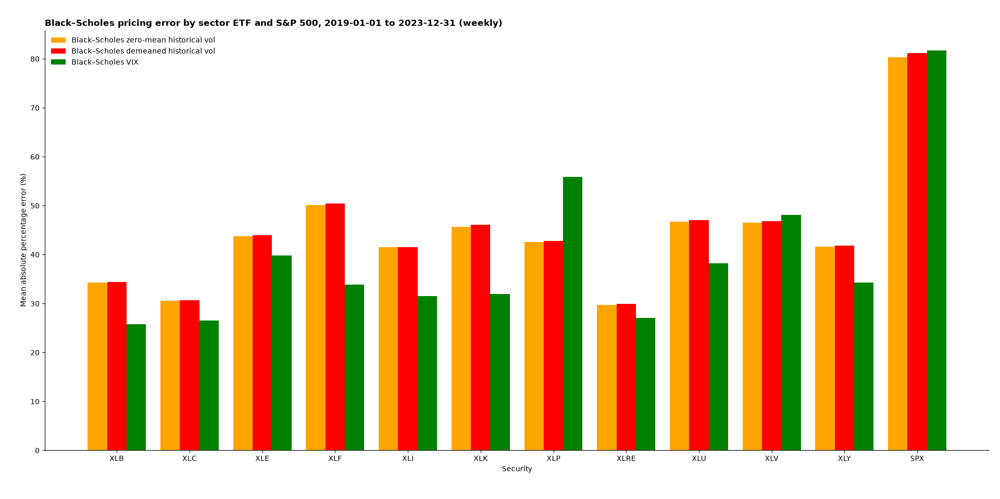
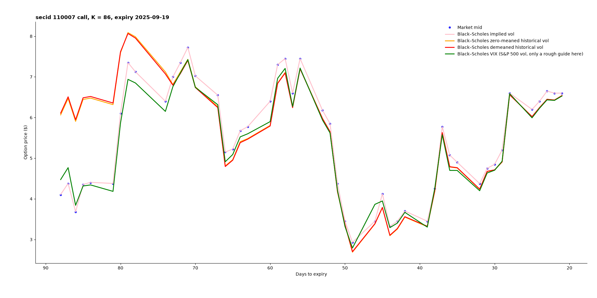

# Lab Book

<!--
Template for a new entry (copy and paste to the bottom):

---

## DD/MM/YYYY – Short title

**Aims:**
- ...

**Work:**

...

**Results:**

(For a second topic on the same day, use a ### subheading.)
-->

---

## 15/10/2026 – Importing data and first Black-Scholes prices

**Work:**
- Imported data from WRDS: data_import_wrds.py
- Added black scholes call function `black_scholes_call(S, K, sigma, r, t)`
- Applied `black_scholes_call(S, K, sigma, r, t)` to call data using mean implied volatility
- Noticed that using the exact implied volatility of a given call doesn't lead to a perfectly priced call. Potentially due to not taking dividends into account.

---

## 21/10/2026 – Dividends and the Merton model

**Aims:**
- Understand why using exact implied volatility doesn't lead to perfect option price, and fix if possible.

**Work:**

A potential cause of the implied volatility not matching is due to not taking into account the dividend yield. The Merton model takes dividends into account in its calculation. When I searched it up I found that European options use the Black-Scholes-Merton model to calculate the implied volatility.

**Results:**

The Merton model decreased the MSE significantly, especially for longer expiry options, however a slight mismatch remains.

---

## 27/10/2026 – Realised volatility

**Aims:**
- To implement realised vol

**Work:**

The top one shows the zero-mean version of the realised volatility which is used more commonly. The bottom one shows the textbook definition of the realised volatility. The zero-mean is used in practice usually, we looked into the reason, it's something to do with the P&L not being accurate when you use the textbook version, but we didn't really understand it. We will implement both to compare accuracy.

We made the data importing methods so they could be imported when needed. We plotted the black-scholes using implied, historical (zero meaned), historical (demeaned) volatilities, and plotted against time.

**Results:**

There is not much difference between the 2 versions of historical vol, however it can be seen that it is sometimes off from the true market price. Since they are almost identical, we can abandon the demeaned historical vol, and use just the zero-mean historical vol, which has a slightly lower RMSE:

| Vol method | RMSE ($) |
|---|---|
| zero-mean historical vol | 48.567 |
| demeaned historical vol | 48.869 |

(measured with `rmse_bs_overall.py` on 06/11/2026)

---

## 02/11/2026 – VIX volatility

**Aims:**
- To implement VIX volatility using black scholes model and compare to realised vol

**Work:**

**Results:**

---

## 02/11/2026 – Plotting per sector

**Aims:**
- To be able to plot per sector

**Work:**

We don't have European options of sectors grouped, so we will use American ones instead. Apparently the European ones are too illiquid to be reliable anyways.

There is no index options data available for certain sectors after 2019, therefore we have to use the ETFs instead. We will have to state the approximation of American options as European options.

### Dividend rate for ETFs

The dividend rate isn't available for ETFs, so we need to calculate it ourselves. Dividend rates for European index options that we have been using until now use CP parity, to calculate the implied dividend rate from the market prices. This contains the market prices so technically if used, it is a circular argument. That means that the prices we have done so far have been circular arguments.

Another way to calculate the dividend rate is by using the past dividends, and assume that it will be the same for the lifetime of the option. This can be:
- **Continuous:** measure the total dividends paid in the last year, divide by the current stock price and convert to continuous compounding: q = ln(1 + D/S)
- **Discrete:** assume the dates and amounts of the dividends paid last year will be the same this year, so calculate the dividends that are suggested to be paid within the lifetime of the option, take away from the stock price, and calc option price using q = 0

We will use the continuous dividend, as it is easier to calculate. We may also want to consider lagging the q used for the previous calcs on the SPX, to stop it from being circular.

---

## 03/11/2026 – Numerical justification for volatility method

**Aims:**
- To obtain numerical justification for volatility method

**Work:**

"The importance of the loss function in option valuation", states that:
1. Models should be trained and evaluated on the same loss function (or quantified error), otherwise it will result in a suboptimal model.
2. When comparing models we should use the same loss function to compare throughout.

Christoffersen & Jacobs found that parameters chosen to minimise squared dollar errors also perform reasonably well when judged by other error measures. We will use the RMSE as it shares the benefits of the MSE but is easier to interpret.

**Results:**

---

## 06/11/2026 – Choosing the error measure

**Aims:**
- To decide what error to use

**Work:**
### Errors wrt option price

Dimitri in our 3rd meeting suggested investigating what the different error quantifying methods measure. We first measure the errors wrt the option price:

The RMSE starts lower, and increases with the options price, whereas the MAPE does the opposite. This is as expected as for the same absolute error, the percentage error will be greater for smaller option prices than greater option prices.

We will use RMSE as the value to compare different option pricing approaches, and to train our ML selector. This is because MSE is the industry standard, so it is easy to compare to other papers. We could also do the whole project but with Median Abs, and compare to RMSE, if we have enough time.

### Sampling dates

I changed the code from taking options from the first day of every month, to taking data from every Wednesday, but if Wednesday is a holiday then take Tuesday instead. I chose Wednesday because it is the least likely day to be a holiday, which allows consistency. This means other literature uses this as well making the results more comparable.

### RMSE by sector

I noticed that the RMSE was much greater for the SPX than the sector ETFs:

This is mainly due to the SPX being a lot more expensive than the ETFs. Which is proven by the MPE (mean percentage error):

The errors can be seen to be a lot closer, however the SPX error is still greater, suggesting that the SPX being more expensive doesn't fully account for the difference in error.

### Dividends, q, for American options

**SPX:** hundreds of companies go ex-dividend on different days, so dividends trickle out almost every day. Treating them as a smooth, continuous yield q is a fair approximation, and this is how q, the value we import, is treated when being computed.

**Sector ETFs & Stocks:** dividends come in four lumps a year, on the Monday after the third Friday of Mar/Jun/Sep/Dec, just after the quarterly option expiry. The options are American so the Black-Scholes formula should not work, however if we choose a period of time in which there are no dividend payments, for a call option, then the Black-Scholes formula can be used.

Figure shows the implied volatility being plugged into the Black-Scholes model working near perfectly, despite the option being American. This is due to choosing a call option during a time when there are no dividend payments.
